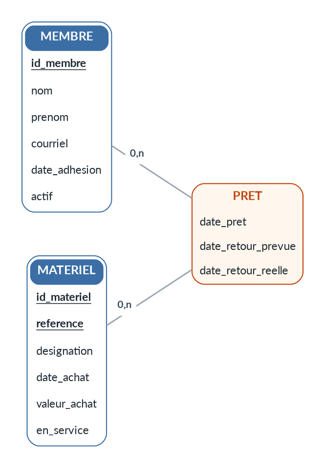

# Genèse de ForegramPM

Matière réunie le 2026-10-04, avant l'ouverture du projet : la vision de
MaaaX, ses premières décisions, et ce qu'a transmis la session
`claude_skills` (germe, mesures, pièges). Conservé tel quel ; ce qui est
tranché ensuite vit dans `AGENTS.md`.

## Ce que veut MaaaX (2026-10-04, peu dégrossi)

- Un outil de **gestion de projet complet**, pilotable par une IA.
- UML et Merise, « etc. ».
- Tout s'écrit en **fichiers texte**, convertis en **images intégrables**
  dans des `.md` ou d'autres documents.
- L'IA **voit ce qu'elle produit** et peut le corriger.
- **Routage automatique** des liens dans les schémas.
- **Plus de contrôle sur l'aspect et sur le placement** (que Graphviz).

## Décisions de MaaaX (2026-10-04)

- **Indépendant de `gimo`** : utilisable en même temps, mais ils ne
  servent pas à la même chose.
- Le périmètre (cœur compilateur de schémas d'abord ou non) se discutera
  avec l'agent du projet, pas ici.
- Principe retenu : placement automatique par défaut, avec la possibilité
  de **fixer** ce qu'on veut (position, couche, ordre, côté d'attache d'un
  lien) — ELK le permettrait, à mesurer.

## 1. Le germe

`claude_skills/dessiner_mcd.py` (5,5 Ko, Python sans
dépendance). Format texte → DOT, Graphviz fait la mise en page. Rend les
quatre conventions Merise : propriétés dans le rectangle, identifiant
souligné, association porteuse de propriétés, cardinalités contre
l'entité. Refuse avec n° de ligne et code ≠ 0 : lien vers entité absente,
cardinalité mal écrite, association à moins de deux liens, bloc en
double. Ne fait pas : CIF, héritage, ternaires, génération MLD/SQL.
Modèle d'exemple : `claude_skills/MCD_GESTPRET.mcd`.
Format documenté dans l'en-tête du script.

## 2. Mesures d'août (à ne pas refaire)

Aucun outil textuel ne réunit les conventions Merise. Mermaid ne rend ni
la notation Merise ni la classe d'association. PlantUML `@startchen` a
toute la sémantique mais pend chaque attribut dans une ellipse : MCD
GestPrêt en 773 × 1034 contre 358 × 477 avec `dessiner_mcd.py`, et sans
`left to right direction` il sort en 2540 × 376. Outils graphiques
dédiés (Looping, JMerise, AnalyseSI) écartés : format binaire, ni diff
ni fusion.

## 3. Constat du 2026-10-04

Le placement de Graphviz est correct, c'est l'**aspect** qui est « hyper
moche ». Un restylage sans toucher au placement (même Graphviz 2.43) plaît
« déjà un peu mieux » à MaaaX. Le DOT restylé (n'existait que dans un
répertoire temporaire) :

Rendu : `dot -Tpng -Gdpi=110 mcd.dot -o mcd.png`

Défauts connus de ce jet :
- (a) Graphviz ne sait pas arrondir le seul haut d'une cellule, d'où le
  bandeau détaché par `CELLSPACING=2` ;
- (b) `margin=0` sur les nœuds est nécessaire, sinon les traits
  s'arrêtent avant les entités ;
- (c) Lato doit être installée — sinon Graphviz substitue en silence :
  prévoir un repli ou embarquer la police (SVG).

## 4. Outillage du poste au 2026-10-04

`dot` présent mais 2.43 (2019) ; `java` présent ; absents : `d2`,
`plantuml`, `mmdc`, `node`. Une version récente de Graphviz, D2 (moteur
ELK) et PlantUML+ELK n'ont pas été évalués — à mesurer avant de choisir
un moteur.

## 5. Pièges et doctrine

À lire dans `claude_skills/skills-dev/` :
`skill-prog-merise/references/{cardinalites,passage,pieges,outillage}.md`
et `skill-prog-uml/references/{quand,outillage,structure}.md`.
Essentiels :
- cardinalités : en Merise contre l'entité décrite, en UML /
  pattes-de-corbeau à l'autre bout — une traduction naïve les inverse ;
- un diagramme se vérifie à l'image (la relire), jamais au code de
  retour : syntaxe valide ≠ dessin lisible ;
- source ET image versionnées à côté du document ; une image ne se
  retouche jamais à la main ;
- une douzaine d'éléments au plus par diagramme ;
- diagrammes jugés utiles : MCD, séquence, machine à états, composants,
  déploiement. Inutiles : cas d'utilisation (une liste fait mieux),
  classes recopiant le code.

## 6. Pour une IA pilote

Format strict qui refuse avec n° de ligne, sortie déterministe (même
source → mêmes octets), rendu PNG que l'agent relit lui-même.

## Côté `claude_skills`

Noté dans son `AGENTS.md` §7 : `skill-prog-merise` et `skill-prog-uml`
renverront à l'outil une fois livré.

## Nom

Pistes proposées le 2026-10-04 : `epure`, `vauban`, `architecte`.
`epure` vérifié le 2026-10-04 et **écarté de fait** : `theodo-group/epure`
sur GitHub est un outil du même domaine (« diagrams-as-code and a WYSIWYG
editor », MIT, créé en juin 2026, actif le jour même). Pris aussi sur
PyPI (sans rapport) et npm (paquet vide de 2022) ; libre sur crates.io.

Seconde série vérifiée le 2026-10-04 (crates.io / PyPI / npm / GitHub) :
- `cordeau` : libre sur les trois registres ; sur GitHub, un seul dépôt
  vide, sans description (`maxgloag/cordeau`) — **le plus dégagé** ;
- `canevas` : libre sur crates.io et PyPI, pris sur npm ; petits projets
  GitHub sans rapport ;
- `lavis` : libre sur les trois registres, mais `salesforce/LAVIS` (11 k
  étoiles, bibliothèque d'IA vision-langage) — collision de recherche ;
- écartés : `vauban` (PyPI, npm, et un bastion PAM actif), `calque` et
  `gabarit` (pris sur crates.io et PyPI).

Jeux de mots anglais (2026-10-04), tous libres sur crates.io / PyPI / npm :
- `graffer` = *graph* + *gaffer* (contremaître en argot britannique) ;
  sur GitHub, un outil de tracés scientifiques homonyme (10 étoiles) ;
- `sightman` = *site manager* → *sight* (l'IA voit ce qu'elle produit) ;
  GitHub : seulement un pseudo ;
- `foregram` = *foreman* + *diagram* ; GitHub : aucun résultat.
- `foremanpm` (idée de MaaaX) : libre sur les trois registres, rien sur
  GitHub ; mais `foreman` seul est très encombré (ddollar/foreman 6 k
  étoiles, theforeman/foreman 3 k, thruwire/foreman, un superviseur
  d'agents) — le suffixe `pm` est ce qui le distingue.
- `foregrampm` : libre sur les trois registres, rien sur GitHub (vérifié le 2026-10-04).
